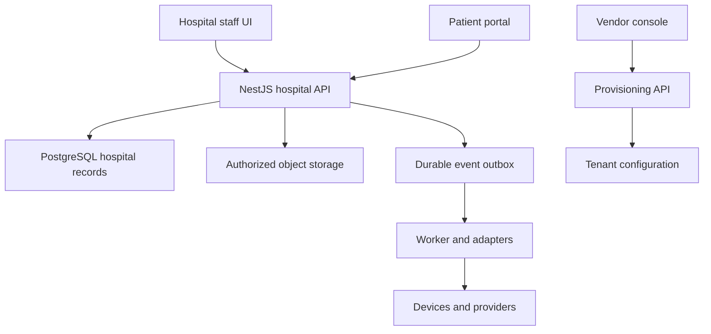

# Application architecture
Purpose: define responsibilities so independently written code fits one coherent system.
Status: PROPOSED modular monolith; confirmed stack direction is in DECISIONS.

## Runtime shape
Next.js staff application -> NestJS API -> PostgreSQL. A worker processes durable background tasks and integrations. Object storage holds reports/attachments behind authorized download handling. SaaS customer administration uses separate permissions and operational credentials from hospital care workflows.

The diagram is a logical design; separate boxes do not require a separate deployed service immediately.

## Proposed Turborepo structure
- apps/hospital-web: staff interface.
- apps/api: NestJS composition root.
- apps/worker: async jobs and adapter execution.
- apps/control-web and control-api: customer provisioning and product administration when needed.
- apps/patient-web: portal once scoped.
- packages/domain-patients, scheduling, clinical, billing, lab: implemented business modules.
- packages/database, contracts, authz, audit, ui, config, testkit: explicitly owned shared capabilities.
Add inpatient, pharmacy, inventory, procedures, finance and workforce packages as those modules become real. Avoid creating dozens of empty packages before ownership is established.

## Ownership and dependency direction
Next.js owns presentation, form interaction and data fetching. NestJS owns business rules and permission checks. For example, the UI can hide a refund button, but the refund command still checks the cashier's authority, invoice state and amount on the server.
Modules expose application interfaces and own writes to their records. Billing consumes validated service-charge requests rather than another module directly changing invoice tables. Cross-module atomic work uses an explicit transaction; notifications and provider effects use durable jobs/outbox rather than pretending an external call is rollbackable.

## Failure behavior
Assume requests/messages can be repeated. Keep idempotency records and reconcile uncertain provider outcomes. Do not hold database transactions during a slow provider request. After a payment or stock operation, the UI displays committed state; a spinner timeout is not evidence of failure or success.

## Pending design decisions
Authentication provider, standard tenancy deployment, queue technology, API schema tooling, storage and monitoring implementation remain proposed in STACK. Pin versions during scaffold work. Production topology, exact interfaces and load targets are not determined by this document alone.
