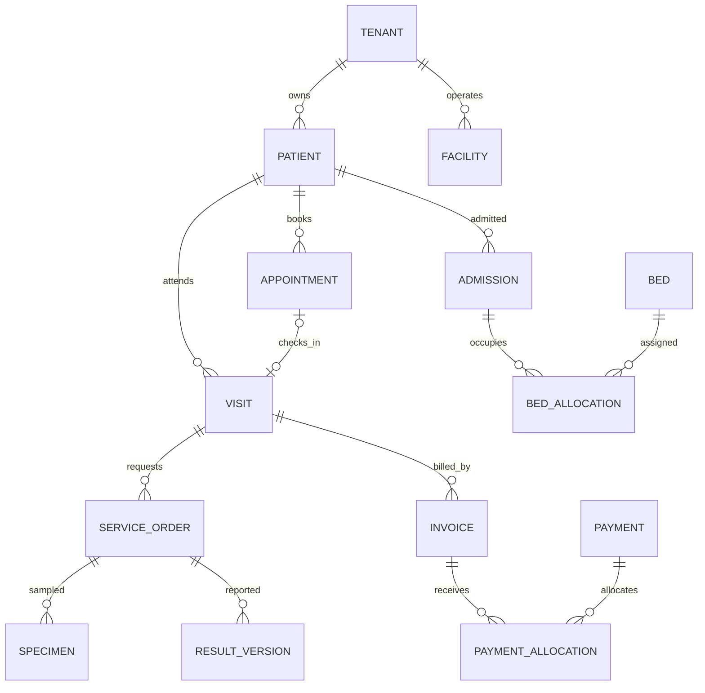

# Database design: logical baseline and physical-design checklist
Purpose: provide concrete starting entities and relationships, then guide physical PostgreSQL design.
Status: PROPOSED logical draft; this is not an approved Prisma schema.

## Logical relationships

Cardinalities are a review draft. A diagnostic order may require multiple specimens; a specimen can support several tests, requiring a specimen-test join in the physical model. Deposit/account allocation and a visit/admission billing relationship require Q-004 resolution. Appointment-to-visit cardinality is for a simple one-attendance booking policy; confirm grouped/cancelled workflows.

## Entity register
Identity: Tenant, Facility, Department, User, Membership, Role, Permission, Practitioner, Patient, PatientIdentifier.
Care: Appointment, Visit, ServiceOrder, ClinicalDocumentVersion, Prescription, PrescriptionLine, Admission, Bed, BedAllocation, TransferEvent.
Diagnostics: TestDefinitionVersion, Specimen, SpecimenTest, ResultVersion, ReviewReleaseEvent, ReportDeliveryEvent.
Money: Charge, PriceVersion, Invoice, InvoiceLine, Payment, Allocation, DepositAccount, Refund, Adjustment.
Stock: Item, Unit, Batch, Store, StockMovement, Indent, Dispense, Return, PurchaseOrder, GoodsReceipt.
Platform: PolicyVersion, AuditEvent, IdempotencyRecord, OutboxEvent, InboxEvent.

## Critical constraints to design
Tenant-scoped uniqueness and same-tenant parent references. One active occupancy per physical bed and allowed admission occupancy policy. Duplicate source charge prevention. Immutable/versioned posted facts. Exact positive/negative money semantics. No invalid result transition. Stock effects and financial effects tied to the accepted operation.
For occupancy concurrency consider exclusion constraints or transaction/locking approaches after selecting interval semantics. Do not claim a particular Prisma model expresses every PostgreSQL constraint automatically.

## Before physical schema approval
For each entity record owner, scope, field meaning, required/unknown rules, keys, references, lifecycle, expected queries and sensitivity. Select constraints/indexes with real query paths. Prove RLS and constraints using application-role PostgreSQL tests. Review deletion/correction, history, migration/backfill, restore and synthetic seeds.

## Example
A visit can have doctor invoice D and service invoice S. Their lines reference distinct charge sources. Payment allocation to D changes D's balance only. No schema constraint should force one invoice per visit in a way that prevents the confirmed billing model.
