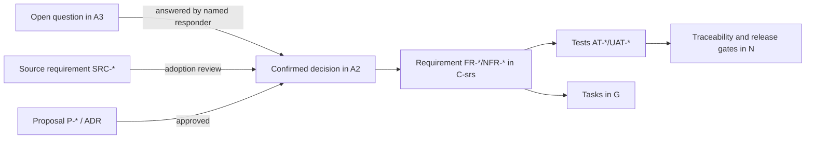

# A2 — Decision register

| Control | Value |
| --- | --- |
| Document | A2 Decision register (authoritative location for all decisions) |
| Version | 0.4.0-draft |
| Status | Confirmed entries are binding; proposed entries await approval |
| Owner role | Product owner (business decisions); technical architect (engineering proposals) |
| Updated | 2026-10-12 |
| Supersedes | `baseline/hospital-saas-planning-kit-v0.3/docs/DECISIONS.md` (all v0.3 IDs are kept unchanged) |
| Related | [A3 Open questions](A3-open-questions.md), [A4 Assumptions and contradictions](A4-assumptions-and-contradictions.md), [ADR index](D2-adr/README.md) |

This register is the **single authoritative location** for decisions. Other documents cite decision IDs and do not restate decisions with different wording. If a document appears to conflict with this register, this register wins, and the conflict is recorded in [A4](A4-assumptions-and-contradictions.md).

## 1. Status vocabulary

| Label | Meaning | Who may change it |
| --- | --- | --- |
| **CONFIRMED** | Settled by the product owner or by the requester in a recorded planning conversation. | Product owner only, through the amendment procedure in section 7. |
| **SOURCE-DERIVED** | Taken from one of the supplied hospital documents S1–S7 (see [SOURCES](../baseline/hospital-saas-planning-kit-v0.3/SOURCES.md)). It describes one hospital's needs. It becomes product behavior only after an adoption decision. v0.3 called this label `SOURCE`. | Domain lead proposes adopt / configure / defer / reject. Product owner approves. |
| **PROPOSED** | An engineering or planning recommendation in this pack. It must not be implemented as if approved, except inside a time-boxed spike. | The technical architect proposes; the product owner or tech lead approves. |
| **OPEN** | An unanswered question. Agents must not choose an answer. See [A3](A3-open-questions.md). | Answered by the named responder. |
| **DEFERRED** | Deliberately parked. It must not be silently implemented or silently ruled out. | Product owner. |

## 2. Confirmed decisions

### 2.1 Carried forward from v0.3 (wording preserved)

| ID | Decision | Implication for design | Date / source |
| --- | --- | --- | --- |
| C-001 | Whole-hospital ERP offered as SaaS to multiple customers. | Customer data and configuration are separated. One maintained product. | v0.3 conversation |
| C-002 | Bangladesh is the initial market. | Capture local operational conventions. Government discussion is deferred (C-021). | v0.3 |
| C-003 | Stack direction: NestJS + Next.js + PostgreSQL + Turborepo. | The backend API owns business writes. Monorepo boundaries apply. | v0.3 |
| C-004 | AI agents drive software development. | Tasks need explicit specifications and evidence. See [G](G-implementation-plan.md). | v0.3 |
| C-005 | Main journey: registration → visit → service order → bill → payment → delivery → outcome → next visit. | Keep this order, but model the lifecycles separately. | v0.3 |
| C-006 | Appointment, walk-in and direct diagnostic visits are all supported. | A diagnostic visit does not need a doctor consultation. | v0.3 |
| C-007 | An appointment booking and the actual visit are distinct. | Check-in creates or links the visit. | v0.3 |
| C-008 | One combined outpatient service invoice per visit. The doctor's visit fee is issued on a separate invoice. | Independent invoices, balances and receipts. | v0.3 |
| C-009 | The cashier collects the doctor fee. | Access to the doctor worklist does not grant cashier authority. | v0.3 |
| C-010 | Cash, card, mobile payment and bank transfer are supported. | Each payment keeps its actual method. | v0.3 |
| C-011 | Payment comes before service. Both full payment and permitted partial/deposit payment are supported. | Service eligibility is configurable. Emergency exceptions are OPEN (Q-005). | v0.3 |
| C-012 | A patient may use the hospital pharmacy or an outside pharmacy. | Outside fulfilment never changes hospital stock. | v0.3 |
| C-013 | Admission can come from an OPD referral, an emergency referral, or a planned/direct route. | Keep the admission source and the linked visit. | v0.3 |
| C-014 | An admission may wait for a bed. | Admission status and bed occupancy are separate. | v0.3 |
| C-015 | Bed transfers are staff-controlled and keep history. | The software records movement. It does not decide clinical need. | v0.3 |
| C-016 | After discharge, the vacated bed must be cleaned before it is available again. | Completing cleaning is an authorized operation. | v0.3 |
| C-017 | IPD uses a running account, deposits/partial payments and final billing. | Final settlement policy is OPEN (Q-006). | v0.3 |
| C-018 | A next appointment may be called a "next visit". | The UI glossary distinguishes the booking from the attended visit. | v0.3 |
| C-019 | Lab processing includes review/release and tracking of rejection and recollection. | Exact reviewer authority is OPEN (Q-009). | v0.3 |
| C-020 | Existing decisions take precedence over the supplied documents. | Conflicts are flagged, and an explicit amendment is sought. | v0.3 |
| C-021 | Government-specific rules are deferred for this discussion. | Earlier legal notes are not turned into current requirements (DEF-001). | v0.3 |

**Identity and workflow agreements carried forward from v0.3 (CONFIRMED):**
- Patient search comes before new registration.
- A possible duplicate produces a warning and is never merged automatically.
- MRN generation belongs to the hospital/customer scope.
- NID is optional.
- An unknown emergency patient can have a temporary identity, reconciled later by an authorized user.
- Direct diagnostic ordering is configured per test.
- Staff assign emergency priority, and the software records who assigned it and when.

These appear as requirements in [C02](C-srs/C02-patients-scheduling.md) and [C10](C-srs/C10-emergency-daycare.md).

### 2.2 New confirmed decisions (planning conversation of 2026-10-12)

The requester answered these during this documentation task. If the requester is not the product owner, the product owner should ratify C-022 to C-025 at the next review. Until then they are treated as CONFIRMED.

| ID | Decision | Implication | Replaces / resolves |
| --- | --- | --- | --- |
| C-022 | Source code is hosted on **GitHub**, and CI/CD runs on **GitHub Actions**. | The full pipeline templates are for GitHub Actions; images go to GHCR. The GitHub plan is still OPEN (Q-055), and it affects environment protection rules. | v0.3 "CI/CD, provider OPEN" |
| C-023 | Code quality uses **self-hosted SonarQube Community Build** (free). | Community Build analyzes only the main branch, so pull requests cannot be gated by Sonar. PR-level quality uses ESLint with the SonarJS plugin plus test and coverage checks. The Sonar quality gate on `main` blocks promotion to release. See [L](L-cicd-sonarqube.md) and [ADR-012](D2-adr/ADR-012-ci-quality-gates.md). | v0.3 "SonarQube concrete gate OPEN" |
| C-024 | Initial customer model: **one hospital per customer organization (tenant)**. Multi-facility groups come later. | The data model keeps the tenant → facility layer, but each tenant starts with exactly one facility. MRN scope is the tenant. Group features are DEFERRED (DEF-002). | **Answers Q-002 for the initial product.** Group behavior stays deferred. |
| C-025 | Staff interface is **bilingual Bangla and English, switchable per user**, with **bilingual printouts**. | Every staff screen, message and print template needs both languages. Names and addresses support Bangla script. Exact per-document print-language rules and numeral style are OPEN (Q-050). | v0.3 "Bangla/English scope OPEN" |

### 2.3 Confirmed by the 2026-10-12 documentation brief

| ID | Decision | Implication |
| --- | --- | --- |
| C-026 | Deployment is designed for **VPS hosting**. No provider, server size or production topology has been selected. | [J](J-vps-deployment-operations.md) describes options and a single-VPS start with an expansion path. Nothing here names a provider as chosen. |
| C-027 | AI agents help **develop** the software. The product has **no autonomous clinical AI** features. | No automated diagnosis, triage, dosing or result interpretation. Clinical decisions remain with authorized staff. |
| C-028 | The "100,000 users" figure is an **unresolved capacity-planning question**, not a validated target or guarantee. | [M](M-capacity-performance.md) models registered, daily-active and concurrent scenarios. No document may claim support for 100k users without measured evidence (Q-041). |
| C-029 | Baseline integrity requirements are mandatory:<br>• tenant isolation<br>• server-side permission enforcement<br>• audit of sensitive actions<br>• clinical-record integrity (released or signed records are corrected, never overwritten)<br>• financial correctness (exact amounts, no duplicate postings, reconciliation) | These apply to every module, even while government rules are deferred. Mechanisms such as RLS are PROPOSED; the obligations are CONFIRMED. |
| C-030 | Old delivery-duration and team-size estimates are **not** commitments. | No calendar dates, durations, team sizes or productivity multipliers appear in this pack. |

## 3. Proposed engineering decisions

All entries are **PROPOSED** until the approver named in the "Approval needed" column accepts them. P-001 to P-006 keep their v0.3 meaning. Later entries refine or add to them. Each consequential proposal has an ADR.

| ID | Proposal | ADR | Approval needed / evidence |
| --- | --- | --- | --- |
| P-001 | Modular monolith: one NestJS API process plus a separate worker process sharing domain packages. | [ADR-001](D2-adr/ADR-001-modular-monolith.md) | Tech lead approval. The scaffold spike shows module boundaries enforced by lint. |
| P-002 | Tenant organization with facilities beneath it. | [ADR-003](D2-adr/ADR-003-tenancy-rls.md) | **Partly settled by C-024.** One facility per tenant initially; the layer stays in the model. |
| P-003 | Shared PostgreSQL schema with `tenant_id` on every tenant-owned row, composite tenant foreign keys, and row-level security as a second barrier. Tenant context is set transaction-locally. | [ADR-003](D2-adr/ADR-003-tenancy-rls.md) | The spike proves RLS with Prisma 7 + `pg` pool + PgBouncer (if used), using the real application role. |
| P-004 | One product codebase with versioned, effective-dated customer configuration (policy versions). No customer-specific branches. | [ADR-001](D2-adr/ADR-001-modular-monolith.md) | Product owner confirms the configurable-policy catalogue in [C00 §6](C-srs/C00-srs-overview.md#6-fixed-product-rules-versus-configurable-hospital-policies). |
| P-005 | Deliver in complete patient-journey slices. | — | Product owner chooses a release boundary (Q-001). See [B §9](B-business-requirements.md#9-proposed-release-boundaries). |
| P-006 | Supporting libraries: TanStack Query, React Hook Form, TanStack Table, Tailwind CSS, BullMQ, Redis-compatible store, S3-compatible storage, OpenAPI, OpenTelemetry. | [D1](D1-stack-assessment-and-versions.md) | Assessment complete in D1. Each library is approved by tech lead after the scaffold spike. |
| P-007 | Use Next.js (confirmed, C-003) as a staff workspace: client-rendered screens with TanStack Query, a server-rendered shell, **no Server Actions or Route Handlers that write business data**, and `output: 'standalone'`. | [ADR-002](D2-adr/ADR-002-nextjs-usage.md) | Tech lead approval. |
| P-008 | First-party authentication owned by NestJS:<br>• opaque server-side sessions in httpOnly cookies<br>• argon2id password hashing<br>• TOTP second factor for privileged roles<br>• account lockout with a visible reason | [ADR-004](D2-adr/ADR-004-authentication.md) | Product owner confirms MFA scope and timeouts (Q-051). |
| P-009 | Zod schemas in `packages/contracts` are the canonical API and event contract. OpenAPI is generated from them, and Prisma types never cross the API boundary. | [ADR-005](D2-adr/ADR-005-contracts.md) | The spike selects the OpenAPI generator compatible with NestJS 12 + Zod 4. |
| P-010 | Transactional outbox, inbox deduplication and idempotency records in PostgreSQL. BullMQ on a Redis-protocol server delivers and schedules jobs; PostgreSQL stays the source of truth. | [ADR-006](D2-adr/ADR-006-outbox-jobs.md) | Tech lead approval. Choose Redis 8 or Valkey after the compatibility spike. |
| P-011 | Money is stored as PostgreSQL `numeric(18,2)` with an explicit currency (BDT default). Domain arithmetic uses integer minor units, and rounding is explicit per policy. | [ADR-007](D2-adr/ADR-007-money.md) | The finance reviewer answers the rounding questions (Q-020). |
| P-012 | Bed occupancy is stored as half-open time intervals (`tstzrange`) with PostgreSQL exclusion constraints. | [ADR-008](D2-adr/ADR-008-bed-occupancy.md) | Tech lead approval. The extra-bed policy (Q-007) may add rules. |
| P-013 | Posted financial facts, stock movements, released results and signed clinical documents are append-only. Changes happen through correction, reversal or amendment records. | [ADR-009](D2-adr/ADR-009-append-only-ledgers.md) | Finance and clinical reviewers agree on the correction flows. |
| P-014 | Printing:<br>• browser print views (HTML/CSS) for routine desk output<br>• server-generated PDF from the same template and record version, rendered by headless Chromium in an isolated container, for archived, reprinted or delivered documents | [ADR-010](D2-adr/ADR-010-printing.md) | UAT on the customer's real printers (Q-046). |
| P-015 | Production starts on a single VPS running Docker Compose: Caddy reverse proxy, web, API, worker, PostgreSQL, Redis-compatible store. Object storage and backups are kept off the VPS. A documented expansion path follows. | [ADR-011](D2-adr/ADR-011-vps-topology.md) | Product owner accepts the single-host availability risk for the pilot, or chooses an expanded topology (Q-043). |
| P-016 | CI gates:<br>• PRs are blocked by lint (including SonarJS rules), typecheck, tests, coverage thresholds, migration checks and security scans<br>• SonarQube Community analysis of `main` gates promotion to release | [ADR-012](D2-adr/ADR-012-ci-quality-gates.md) | Tech lead approval. Confirm the GitHub plan (Q-055). |
| P-017 | Keep Jest (supplied foundation) for unit and API tests on Node ≥ 24.9 with ESM. Adopt Vitest only by an explicit decision if the Jest + ESM spike fails. | [ADR-013](D2-adr/ADR-013-test-runner.md) | Tech lead; resolves Q-054. |
| P-018 | Object storage through the S3 API. Do not adopt MinIO Community Edition for new production use: binary and image distribution stopped, and the repository is archived. Use provider object storage or a maintained self-hosted alternative (SeaweedFS, Garage). | [ADR-014](D2-adr/ADR-014-object-storage.md) | DevOps lead. Choose after the provider is selected (Q-044). |
| P-019 | Worklists refresh by polling with short intervals and conditional requests. Server-Sent Events are a later optimization when measurements justify them. | [ADR-015](D2-adr/ADR-015-worklist-refresh.md) | Tech lead. Revisit with load-test evidence ([M](M-capacity-performance.md)). |
| P-020 | Payment allocation is recorded at invoice-line level so per-service eligibility can be computed. The *policy* for choosing lines stays OPEN (Q-004, Q-024). | [ADR-016](D2-adr/ADR-016-payment-allocation.md) | The finance reviewer answers Q-004. |
| P-021 | Version pins for scaffold, per [D1 §4](D1-stack-assessment-and-versions.md#4-verified-versions-and-pinning-recommendation):<br>• Node 24 LTS now, re-evaluate Node 26 after its LTS promotion<br>• TypeScript 6.0.x<br>• NestJS 12.1.x<br>• Next.js 16.4.x plus the 2026-10-14 security release<br>• Prisma 7.10.x (CLI and client together)<br>• PostgreSQL 18.x current minor<br>• pnpm (exact version recorded in `packageManager`)<br>• Turborepo 2.11.x | [D1](D1-stack-assessment-and-versions.md) | Re-verify on the scaffold date and record the lockfile commit. |
| P-022 | Bilingual implementation:<br>• `next-intl` message catalogs (`bn-BD`, `en`)<br>• Noto Sans Bengali / Noto Sans fonts self-hosted<br>• print templates carry a language per output<br>• stored person names keep the script as entered | [ADR-017](D2-adr/ADR-017-localization.md) | Native-speaker review of terminology (Q-050). |

## 4. Deferred items

| ID | Item | Why deferred | Revisit trigger |
| --- | --- | --- | --- |
| DEF-001 | Government-specific requirements: statutory rules, mandatory reports, national health-record exchange, legally required hosting/retention. | Owner request (C-021). | Owner opens a separately scoped review. Its absence is **not** a completed compliance assessment. |
| DEF-002 | Multi-facility hospital groups: shared patients across facilities, group-level reporting, cross-facility transfers, facility-specific MRN series. | C-024. | First customer with more than one facility. |
| DEF-003 | Offline operation and synchronization. | Not requested. It is a large design commitment. | Pilot downtime discussion (Q-043) shows paper fallback is insufficient. |
| DEF-004 | Full PACS/archive implementation. | A radiology module does not imply a PACS. | A customer requires DICOM storage or viewing (Q-028). |
| DEF-005 | Dedicated per-customer deployments and database-per-tenant placement. | Shared tenancy is the proposed standard (P-003). | A contractual or capacity need ([M §8](M-capacity-performance.md#8-bottleneck-detection-and-expansion-triggers)). |
| DEF-006 | SaaS subscription billing, plans and commercial lifecycle automation. | Commercial decisions are OPEN (Q-052). | Before onboarding a second paying customer. |

## 5. Superseded or partly answered items

| Earlier item | Now | Note |
| --- | --- | --- |
| v0.3 Q-002 (one hospital or group?) | Answered for the initial product by **C-024**. | Group behavior → DEF-002. |
| v0.3 "Bangla/English scope OPEN" | **C-025**. | Detail questions remain in Q-050. |
| v0.3 "CI/CD provider OPEN" | **C-022**. | — |
| v0.3 "SonarQube concrete gate OPEN" | **C-023** + P-016. | — |

## 6. How decisions flow into the pack



## 7. Amendment procedure

1. Keep stable IDs. Never reuse or renumber an ID.
2. A change to a CONFIRMED item creates a new row, for example `C-008a`, or a new ID with a "Replaces" note. Record:
   - date
   - approver
   - reason
   - the replaced text
   - affected workflows, requirements, data, contracts and tests
   - migration implications
3. Mark the old row "Superseded by …". Do not edit its wording to look as if it was always agreed.
4. Update [N Traceability](N-traceability-readiness.md) and any affected ready tasks in the same change.
5. ADRs keep their alternatives and consequences after approval. An ADR is superseded by a later ADR, never deleted.

## 8. Decision record template

```text
ID:            C-0NN | P-0NN | DEF-0NN
Title:
Status:        CONFIRMED | PROPOSED | DEFERRED | SUPERSEDED
Date / approver:
Context (link question/source):
Decision:
Consequences (data, contracts, UI, tests, operations):
Replaces:
Linked requirements / ADR / tests:
```
