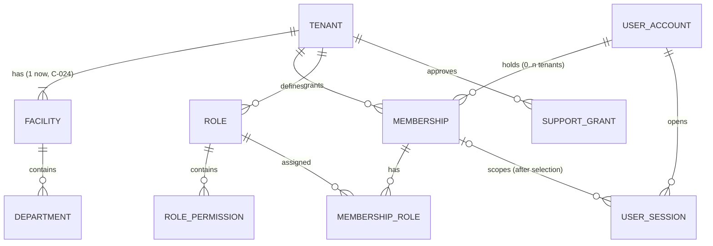
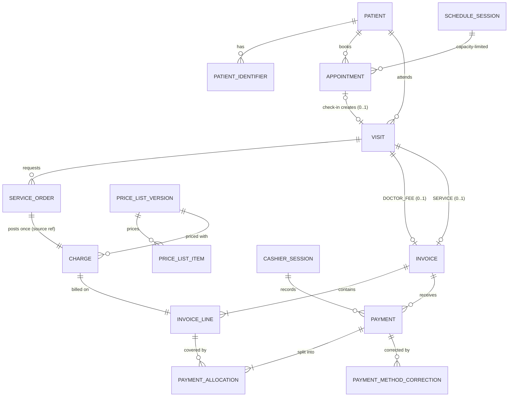
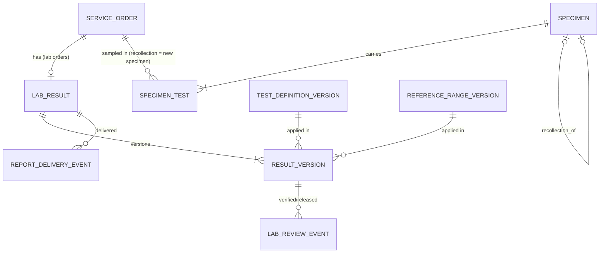
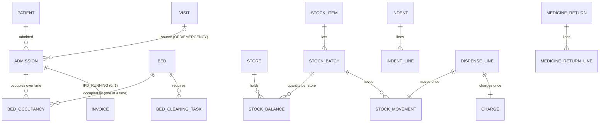

# E — Database design

| Control | Value |
| --- | --- |
| Document | E Database design (logical model, PostgreSQL physical proposal, RLS, Prisma mapping, lifecycle) |
| Version | 0.4.0-draft |
| Status | **PROPOSED.** The draft SQL is a review artifact, **not an approved migration**. Field lists cover the first slices in depth and later modules in outline. |
| Owner role | Technical architect + integrator (schema owner) |
| Updated | 2026-10-12 |
| Artifacts | [`templates/sql/draft-core-schema.sql`](../templates/sql/draft-core-schema.sql) · [`draft-validation-probes.sql`](../templates/sql/draft-validation-probes.sql) · [`draft-validation-output.txt`](../templates/sql/draft-validation-output.txt) |
| Depends on | [C-srs](C-srs/C00-srs-overview.md), [D](D-system-design.md), ADR-003, ADR-007, ADR-008, ADR-009 |

## 1. Design principles

1. **Lifecycles are separate records.** These are never one status column:
   - appointment / visit
   - order / result
   - prescription / dispense
   - charge / invoice line / payment / allocation
   - admission / occupancy
2. **Tenant on every tenant-owned row**, enforced three ways: application filter, composite foreign keys, forced RLS (ADR-003).
3. **Posted facts are append-only.** Corrections are new rows (ADR-009).
4. **The database enforces the invariants that races would break:**
   - one bed occupancy
   - line over-allocation
   - capacity
   - negative stock
   - duplicate source postings
   - one service invoice per visit
5. **Exact money and explicit time** (ADR-007, NFR-TIME-001).
6. **Prisma for most tables, SQL for what Prisma cannot express** (§7).

## 2. Entity ownership

Only the owning module writes these tables. Other modules call the owner's interface (D §5).

| Module | Owned tables (core) |
| --- | --- |
| `mod-identity-access` | `tenant`, `facility`, `department`, `user_account`, `membership`, `role`, `role_permission`, `membership_role`, `user_session`, `support_grant`, `tenant_entitlement`, `provisioning_run` |
| `platform` | `number_sequence`, `policy_version`, `audit_event`, `outbox_event`, `inbox_event`, `idempotency_record`, `integration_inbox` |
| `mod-patients` | `patient`, `patient_identifier`, `patient_identity_history`, `practitioner` |
| `mod-scheduling` | `schedule_session`, `appointment` |
| `mod-clinical` | `visit`, `consultation`, `clinical_document`, `clinical_document_version`, `service_order`, `prescription`, `prescription_line`, `order_cancellation_request` |
| `mod-billing` | `service_item`, `price_list_version`, `price_list_item`, `charge`, `invoice`, `invoice_line`, `cashier_session`, `payment`, `payment_allocation`, `payment_method_correction`, `receipt_print` (via `print_event`), later `deposit_account`, `discount`, `refund`, `charge_adjustment` |
| `mod-lab` | `test_definition_version`, `reference_range_version`, `report_template_version`, `specimen`, `specimen_test`, `lab_result`, `result_version`, `lab_review_event`, `report_delivery_event`, `lab_report_rendition` |
| `mod-ipd` | `bed`, `admission`, `bed_occupancy`, `bed_transfer_event`, `bed_cleaning_task` |
| `mod-nursing` | `indent`, `indent_line`, `medicine_return`, `medicine_return_line` |
| `mod-pharmacy` | `medicine` (catalogue extension of `stock_item`), `dispense`, `dispense_line` |
| `mod-inventory` | `store`, `stock_item`, `stock_batch`, `stock_balance`, `stock_movement`, `stock_transfer`, `stock_adjustment`, later procurement tables |
| `mod-reporting` | `report_job`, `report_export`, read models/materialized views |
| `platform-print` | `print_template_version`, `print_event` |

## 3. Logical ERD and cardinalities

### 3.1 Identity, access and tenancy



### 3.2 Patient journey and billing



**Cardinality notes:**
- A visit has **0..1 doctor-fee invoice and 0..1 service invoice** (C-008; partial unique indexes). A diagnostic visit has no doctor-fee invoice.
- An appointment yields **at most one visit** (`UNIQUE (tenant_id, appointment_id)` on `visit`).
- A charge maps to **exactly one** invoice line (`UNIQUE (tenant_id, charge_id)`).
- A payment belongs to **one invoice** (interim, Q-024). Its allocations target lines of that invoice. For IPD running accounts, `invoice_line_id` may be NULL (ADR-016).

### 3.3 Laboratory



- A specimen can carry several tests, and a test may need several specimens (via a recollection). Hence `specimen_test` is many-to-many.
- `lab_result` holds the **mutable status pointer**. `result_version` holds **immutable content**.

### 3.4 Inpatient and stock



## 4. Tenant and facility scope, identifier rules

| Rule | Detail |
| --- | --- |
| Internal IDs | `uuid` generated by PostgreSQL 18 `uuidv7()`: time-ordered, which gives better index locality than v4 and does not leak business counts. Never shown to staff as business numbers. |
| Composite uniqueness | Every tenant-owned table has `UNIQUE (tenant_id, id)` so children can reference `(tenant_id, parent_id)`. |
| Business numbers | MRN, invoice, receipt, specimen and admission numbers are **unique per tenant**. They are generated from `number_sequence` rows with `UPDATE … RETURNING` inside the business transaction, formatted per CP-09 (Q-034). Gaps can occur when a transaction rolls back. Gap-free numbering is not promised (FR-CFG-003). |
| Facility scope | Records with a physical location carry `facility_id` (visit, bed, store, cashier session, schedule). With one facility per tenant (C-024) this is constant today, but kept for DEF-002. |
| Phone and NID | Not unique keys (v0.3 DATA). Indexed for duplicate detection only. |
| Global tables | `user_account` (a person may hold several tenant memberships) and `user_session` (looked up by token hash) are not tenant-scoped. Access goes only through the identity module. |
| Control-plane tables | `tenant`, `tenant_entitlement`, `provisioning_run`. The vendor control plane reads them with `hms_control`, which has no grants on business tables (probe P24). |

## 5. Data dictionary (core entities)

Types are PostgreSQL types. "Sensitivity" drives log redaction, masking and audit-on-read.

### 5.1 `patient`

| Column | Type | Null | Meaning / rule | Sensitivity |
| --- | --- | --- | --- | --- |
| `tenant_id` | uuid | no | Owning hospital; from session | — |
| `id` | uuid | no | Internal identity; never changes (SRC-N05) | — |
| `mrn` | text | no | Tenant-unique business number (FR-PAT-002) | identifying |
| `identity_status` | text | no | `CONFIRMED` / `TEMPORARY` (FR-PAT-004) | — |
| `name_bn`, `name_en` | text | yes | As entered. At least one is required unless `TEMPORARY` (CHECK). Script preserved. | identifying |
| `sex` | text | no | `MALE`/`FEMALE`/`OTHER`/`UNKNOWN` (code list to confirm, Q-035) | identifying |
| `birth_date` | date | yes | Only when known | identifying |
| `birth_date_precision` | text | no | `EXACT`/`YEAR_ESTIMATED`/`UNKNOWN`. No fabricated dates (FR-PAT-006). | — |
| `reported_age_years`, `reported_age_on` | smallint, date | yes | Age as reported, and when | identifying |
| `phone_raw`, `phone_normalized` | text | yes | Raw as entered; normalized per FR-PAT-003 for search | contact |
| `address_text` | text | yes | Free text until the structure is decided (Q-035) | contact |
| `created_at`, `created_by`, `version` | — | no | Audit and optimistic concurrency | — |

### 5.2 `patient_identifier`

| Column | Type | Meaning |
| --- | --- | --- |
| `kind` | text | `NID`, `BIRTH_REGISTRATION`, `PASSPORT`, `OTHER` |
| `value` | text | Full value. **Proposal:** encrypt at application level (AES-GCM with a key from the secret store), so database backups and read replicas do not expose raw NIDs. A keyed hash column would then support equality search. Decide in T-PAT-03. |
| `value_last4` | text | For masked display (FR-PAT-007) |

### 5.3 `visit`, `appointment`, `schedule_session`

See the draft SQL for all columns. Key rules:
- `visit.kind` ∈ (`OPD_CONSULTATION`, `DIAGNOSTIC`, `EMERGENCY`). A consultation requires `attending_practitioner_id` (CHECK).
- `visit.appointment_id` is unique per tenant.
- `schedule_session.booked_count` is constrained `BETWEEN 0 AND capacity`. Incrementing it in the booking transaction resolves the last-slot race (probe P14).

### 5.4 Billing

| Table.column | Type | Rule |
| --- | --- | --- |
| `invoice.type` | text | `DOCTOR_FEE`, `SERVICE`, `IPD_RUNNING`, `PHARMACY` (the last two are PROPOSED types) |
| `invoice.total`, `invoice.paid` | numeric(18,2) | Projections maintained in the same transaction as lines and allocations. `0 ≤ paid ≤ total`. Reconciled nightly (D §9.5). |
| `invoice.currency` | char(3) | `BDT` (AS-001) |
| `charge.(source_module, source_type, source_id, source_event)` | text × 4 | Unique per tenant: the **source posting reference** (FPR-09). Examples: `('clinical','service_order','<uuid>','ORDERED')`, `('ot','procedure','<uuid>','COMPLETED')`, `('ipd','BED_DAY_MANUAL','<adm>:<bed>:2026-11-02','POSTED')`. |
| `charge.price_list_version_id` | uuid | The price version actually used (FR-SAA-005) |
| `invoice_line.category` | text | `MEDICINE` / `NON_MEDICINE` for independent subtotals (SRC-B03) |
| `invoice_line.allocated_amount` | numeric(18,2) | Maintained transactionally. Constraint `invoice_line_allocation_within_net` (probe P11, race C2). |
| `invoice_line.eligibility` | text | Derived from allocation and the policy version (CP-02), recomputed in the payment transaction. Stored for worklist performance. |
| `payment.method` | text | Actual method (C-010). `provider_label` such as "bKash". |
| `payment.receipt_number` | text | Tenant-unique |
| `payment_allocation.invoice_line_id` | uuid | NULL only for IPD running-account allocations (ADR-016) |
| `cashier_session` | — | One `OPEN` per cashier (partial unique). The reviewer must differ from the cashier (CHECK). |

### 5.5 Laboratory, inpatient, stock, platform

| Table | Key columns and rules |
| --- | --- |
| `specimen` | `specimen_number` unique per tenant; `status`; `rejected_reason` required when `REJECTED`; `recollection_of_id`; `location_snapshot` (ward/room/bed at collection, SRC-L10) |
| `lab_result` | One per lab order; `status`; `current_version_no`; `released_version_no` |
| `result_version` | `(lab_result_id, version_no)` unique; `result_values` jsonb validated by a Zod schema (analyte, value, unit, flag); references test definition, range and template versions; `amends_version_no` + `amendment_reason`. **No UPDATE grant.** |
| `lab_review_event` | `VERIFIED`, `RELEASED`, `SENT_BACK`, `SUPERSEDED` events with actor and time |
| `admission` | `state`, `financial_clearance`, `departed_with_dues`, `route` (+ `source_visit_id` required unless `PLANNED`); one active admission per patient (partial unique, PROPOSED fixed rule) |
| `bed_occupancy` | `period tstzrange '[)'`; exclusion constraints `bed_single_occupancy` and `admission_single_primary_bed` (P07–P09, race C1); `entered_at` vs effective time (FR-IPD-016) |
| `stock_balance` | `on_hand ≥ 0` (`stock_balance_non_negative`, P21) |
| `stock_movement` | Signed quantity in the base unit; unique `(source_type, source_id, source_line_id, movement_type)` so a retried dispense or GRN moves stock once (P22) |
| `audit_event` | Partitioned by month on `occurred_at`; `details` holds IDs and codes only |
| `outbox_event` | `published_at` NULL means pending; partial index on pending rows |
| `idempotency_record` | PK `(tenant_id, actor_user_id, idem_key)`; `request_hash`; `status`; `response`; `expires_at` |

## 6. Row-level security and database roles

### 6.1 Roles

| Role | Login | Purpose | Key privileges |
| --- | --- | --- | --- |
| `hms_owner` | no | Owns schema and tables | DDL |
| `hms_migrator` | yes | Runs migrations (member of `hms_owner`), used only by the migration job | DDL |
| `hms_app` | yes | API and worker business access | `SELECT, INSERT, UPDATE` on business tables; **no UPDATE on append-only tables**; column-level UPDATE on partially mutable tables; DELETE only on `idempotency_record`, `user_session`; `NOBYPASSRLS` |
| `hms_readonly` | yes | Reporting / read replica access | `SELECT`; RLS applies, so it uses `withTenant` like the app |
| `hms_relay` | yes | Outbox relay (worker) | `BYPASSRLS` but **only** `SELECT` + `UPDATE(published_at, attempts)` on `outbox_event` |
| `hms_control` | yes | Vendor control plane | `BYPASSRLS` but grants only on `tenant` (and later `tenant_entitlement`, `provisioning_run`) |
| `hms_backup` | yes | pgBackRest | replication/backup privileges per pgBackRest docs |

`BYPASSRLS` roles are safe only because their table grants are minimal. Probes P23 and P24 show they cannot read `patient`.

### 6.2 Policies

```sql
-- every tenant-owned table (generated in a migration loop; see draft SQL)
ALTER TABLE hms.patient ENABLE ROW LEVEL SECURITY;
ALTER TABLE hms.patient FORCE ROW LEVEL SECURITY;
CREATE POLICY tenant_isolation ON hms.patient
  USING (tenant_id = hms.current_tenant_id())
  WITH CHECK (tenant_id = hms.current_tenant_id());

-- current_tenant_id(): NULLIF(current_setting('app.tenant_id', true), '')::uuid
-- After a transaction-local set_config ends, the setting reads as '' (probe P15) → NULL → no rows.
```

**Special policies:**
- `tenant`: `id = current_tenant_id()`.
- `membership`: `tenant_id = current_tenant_id() OR user_id = current_app_user_id()`, so a just-authenticated user can list their own memberships before choosing a tenant (probe P18).

**Context protocol (`withTenant`):**

```ts
// packages/database/src/with-tenant.ts (ILLUSTRATIVE)
export async function withTenant<T>(ctx: TenantCtx, fn: (tx: Tx) => Promise<T>): Promise<T> {
  return prisma.$transaction(async (tx) => {
    await tx.$executeRaw`SELECT set_config('app.tenant_id', ${ctx.tenantId}, true),
                                set_config('app.user_id',   ${ctx.userId ?? ''}, true)`;
    return fn(tx);
  }, { timeout: 5_000, isolationLevel: 'ReadCommitted' });
}
```

**Guarantees shown by the draft probes** (PostgreSQL 18.4, [§13](#13-validation-performed-on-the-draft-sql)):
- no context → no rows and no inserts (P02, P03)
- a wrong-tenant write is rejected (P04)
- a cross-tenant parent reference is rejected (P05)
- `row_security = off` cannot bypass RLS (P16)
- context does not survive commit (P15)

**What still needs the spike (T-FND-04):** the same behavior through Prisma 7 + `@prisma/adapter-pg` + the pool, under concurrency, after errors, and with PgBouncer if adopted.

### 6.3 RLS coverage check (CI)

```sql
-- fails the build if a table with tenant_id lacks forced RLS or a policy (AT-DB-001)
SELECT c.relname FROM pg_class c
JOIN pg_namespace n ON n.oid = c.relnamespace AND n.nspname = 'hms'
JOIN pg_attribute a ON a.attrelid = c.oid AND a.attname = 'tenant_id'
WHERE c.relkind IN ('r','p') AND c.relname NOT IN ('user_session')
  AND (NOT c.relrowsecurity OR NOT c.relforcerowsecurity
       OR NOT EXISTS (SELECT 1 FROM pg_policy p WHERE p.polrelid = c.oid));
```

## 7. Prisma mapping and PostgreSQL features needing SQL

**Proposed layout:** `packages/database/prisma/schema/*.prisma`, one file per module (multi-file schema; confirm support in spike), `prisma.config.ts`, and generated client output inside the package (Prisma 7 requires an explicit `output`).

```prisma
// packages/database/prisma/schema/billing.prisma  (ILLUSTRATIVE — not an approved schema)
model InvoiceLine {
  tenantId          String   @map("tenant_id") @db.Uuid
  id                String   @id @default(dbgenerated("uuidv7()")) @db.Uuid
  invoiceId         String   @map("invoice_id") @db.Uuid
  chargeId          String   @map("charge_id") @db.Uuid
  lineNo            Int      @map("line_no")
  category          String
  netAmount         Decimal  @map("net_amount") @db.Decimal(18, 2)
  allocatedAmount   Decimal  @default(0) @map("allocated_amount") @db.Decimal(18, 2)
  status            String   @default("ACTIVE")
  eligibility       String   @default("NOT_ELIGIBLE")
  version           Int      @default(1)
  updatedAt         DateTime @default(now()) @map("updated_at") @db.Timestamptz(6)

  invoice Invoice @relation(fields: [tenantId, invoiceId], references: [tenantId, id])
  charge  Charge  @relation(fields: [tenantId, chargeId], references: [tenantId, id])

  @@unique([tenantId, id])
  @@unique([tenantId, chargeId])
  @@unique([tenantId, invoiceId, lineNo])
  @@map("invoice_line")
  @@schema("hms")
}

model Invoice {
  // …
  @@unique([tenantId, visitId], map: "invoice_one_service_per_visit", where: raw("type = 'SERVICE'"))
  // Partial indexes are supported through `where` (Prisma docs); confirm exact syntax in the spike.
}
```

| PostgreSQL feature | Prisma support | Approach |
| --- | --- | --- |
| Composite FKs `(tenant_id, x_id)` | Supported (`@relation(fields: [tenantId, xId], references: [tenantId, id])`) | Use everywhere |
| `uuidv7()` default | `dbgenerated("uuidv7()")` | Use |
| `numeric(18,2)` | `Decimal @db.Decimal(18,2)` | Map to `Money` in repositories (ADR-007) |
| `timestamptz` | `DateTime @db.Timestamptz(6)` | Use |
| Partial unique indexes | Supported via `where` | Use; verify generated SQL in review |
| `UNIQUE NULLS NOT DISTINCT` | Not expressible | SQL migration |
| CHECK constraints (named) | Not expressible | SQL migration. **Name them**, because API error mapping uses constraint names (e.g., `invoice_line_allocation_within_net` → `AMOUNT_EXCEEDS_BALANCE`). |
| Exclusion constraints, `tstzrange`, `btree_gist` | Not expressible; range type is `Unsupported("tstzrange")` | SQL migration. Occupancy writes and reads use `$queryRaw`/TypedSQL in `mod-ipd/infrastructure`. |
| RLS enable/force/policies, roles, grants, column grants | Not expressible | SQL migrations, plus the CI coverage check (§6.3) |
| Table partitioning (`audit_event`) | Not expressible | SQL migration. A maintenance job creates future partitions (as `hms_migrator`, through a migration-style job or a `SECURITY DEFINER` function owned by `hms_owner`). |
| Trigram/GIN indexes | Partially (index types are limited) | SQL migration |
| Extensions | Not created by Prisma | `CREATE EXTENSION` in the first SQL migration (shadow DB needs them too) |

**Migration workflow:**
1. Edit the Prisma schema.
2. `prisma migrate dev --create-only`.
3. Hand-edit SQL for unsupported features.
4. The integrator reviews.
5. Commit.

CI applies all migrations to a fresh PostgreSQL 18 and runs `prisma migrate diff` to detect drift (H §9).

## 8. Money, units, time, versioning and correction rules

| Topic | Rule | Status |
| --- | --- | --- |
| Money storage | `numeric(18,2)` + `currency char(3)` | PROPOSED (ADR-007) |
| Money arithmetic | `Money` value object (bigint minor units). No JS `number` arithmetic for amounts. | PROPOSED |
| Rounding | None unless CP-07 is configured. Then an explicit adjustment line with its own source reference. | OPEN (Q-020) |
| Sign conventions | Charges ≥ 0. Credits and reversals are separate rows with their own type (later). Payments > 0. Allocation > 0. | PROPOSED |
| Quantities | `numeric(14,3)` in the item's **base unit**; `unit` text on catalogue items | PROPOSED; conversions OPEN (Q-014) |
| Instants | `timestamptz` (stored UTC) for every event time | CONFIRMED (v0.3 DATA) |
| Business dates | `date` columns computed in the **facility timezone** (`facility.timezone`, default `Asia/Dhaka`): cash day, session date, service date, bed day. Never derived from server local time. | CONFIRMED (v0.3) |
| Effective dating | `policy_version` and `price_list_version` have `effective_from`. Records store the version ID they used. | PROPOSED (P-004) |
| Record versions | `version integer` on mutable rows; `UPDATE … WHERE version = $expected`; increment on each change | PROPOSED |
| Content versions | Immutable version rows (`result_version`, `clinical_document_version`, template versions) with a monotonically increasing `version_no` | PROPOSED |
| Corrections | Insert correction rows linked to the original: `payment_method_correction`; later `charge_adjustment`, `refund`, amendment versions. The original stays visible. | CONFIRMED principle (C-029) |
| Deletion | No hard delete of business records. Drafts may be discarded (status change). Purge only for expiring technical rows (sessions, idempotency). | CONFIRMED principle |

## 9. Key structures in detail

### 9.1 Payment allocations

```text
Payment P (CARD 300.00) ─┬─ Allocation A1 300.00 → InvoiceLine L1 (CBC, net 300.00)
                         │   L1.allocated_amount 0.00 → 300.00 ; L1.eligibility → ELIGIBLE
Invoice S.paid 0.00 → 300.00 ; S.status → PARTIALLY_PAID (L2 X-ray 700.00 unpaid)
```

**Transaction order** (one transaction):
1. `SELECT … FROM invoice WHERE id = S FOR UPDATE`.
2. Validate: lines are active and each allocation is ≤ the remaining amount.
3. Insert the payment.
4. Insert the allocations.
5. Update the lines (`allocated_amount`, `eligibility`).
6. Update `invoice.paid` and `status`.
7. Increment the receipt sequence.
8. Insert the audit and outbox rows.
9. Complete the idempotency record.

The line check constraint protects against any path that skips step 1 (race C2).

### 9.2 Admission and occupancy intervals

- Current occupancy: `upper(period) IS NULL` (partial index `bed_occupancy_current`).
- Point-in-time query: `WHERE period @> timestamptz '2026-11-02 18:00+06'`.
- Bed-day computations for any future rule (Q-007) use interval arithmetic in the facility timezone. **No rule is encoded today.**

### 9.3 Stock movements

- `stock_movement` is the ledger. `stock_balance` is the projection, updated in the same transaction with `on_hand ≥ 0`.
- Reconciliation: `SUM(quantity) GROUP BY store, batch` = `on_hand`.
- Transfers produce `TRANSFER_OUT` and `TRANSFER_IN` rows at dispatch and receipt times, with in-transit derived from the transfer document.

### 9.4 Result versions

- Entering or re-entering before verification creates a new `result_version`. `lab_result.current_version_no` points to it.
- Verify and release write `lab_review_event` rows and update the `lab_result` status pointer.
- An amendment creates `version_no + 1` with `amends_version_no`. The previously released version gets a `SUPERSEDED` review event.
- Content rows are never updated (no UPDATE grant), so a released report is reproducible from its version and template version.

### 9.5 Audit

- Partitioned monthly. Indexes on `(tenant_id, target_type, target_id, occurred_at)` and `(tenant_id, actor_user_id, occurred_at)`.
- `details` stores IDs, codes and changed-field names, not clinical values (FR-AUD-006).
- Retention and partition archival are OPEN (Q-053). Partitions make archival cheap: detach, export, store.

### 9.6 Source-posting references

| Source | `source_module` / `source_type` / `source_id` / `source_event` |
| --- | --- |
| Consultation fee | `clinical` / `visit` / visit ID / `DOCTOR_FEE` |
| Service order | `clinical` / `service_order` / order ID / `ORDERED` |
| Dispense line | `pharmacy` / `dispense_line` / line ID / `ISSUED` |
| OT procedure | `ot` / `procedure` / procedure ID / `COMPLETED` |
| Manual bed charge | `ipd` / `BED_DAY_MANUAL` / `adm:bed:date` / `POSTED` |
| Accepted return credit (later) | `pharmacy` / `return_line` / line ID / `CREDITED` |

## 10. Query patterns, indexes, growth and reporting strategy

### 10.1 Hot query patterns

| Query | Index / technique |
| --- | --- |
| Patient search by phone | `(tenant_id, phone_normalized)` |
| Patient search by name (bn/en, fuzzy) | GIN `(tenant_id, name_xx gin_trgm_ops)` (btree_gin + pg_trgm); limit 20; similarity threshold tuned |
| Patient search by MRN | unique `(tenant_id, mrn)` |
| Doctor worklist | `visit_worklist_idx (tenant_id, attending_practitioner_id, status, arrived_at) WHERE status = 'OPEN'` plus a join to doctor-fee line eligibility |
| Cashier: visit invoices | `invoice (tenant_id, visit_id)` partial uniques; lines by `(tenant_id, invoice_id, line_no)` |
| Lab worklists by stage | `(tenant_id, status, …)` on `specimen` / `lab_result` with keyset pagination on `(updated_at, id)` |
| Bed board | `bed (tenant_id, facility_id, ward_code)` + `bed_occupancy_current` |
| Collection report | `payment_day_idx (tenant_id, received_at)`, `payment_session_idx` |
| Audit search | `audit_event` indexes per §9.5 |

Keyset pagination everywhere lists can grow (D §8.2). Every list query has an explicit `LIMIT`.

### 10.2 Expected growth (synthetic planning inputs, AS-011)

**Example "medium hospital" profile (synthetic):**
- 800 OPD/diagnostic visits/day
- 2.5 orders per visit
- 1.6 invoices per visit
- 1.8 payments per visit
- 2 lab results per visit
- 60 IPD admissions/day
- ~25 audit events per visit-equivalent

| Table | Rows/day (approx.) | Rows/year | Approx. bytes/row incl. indexes (planning guess) | Year size |
| --- | --- | --- | --- | --- |
| `visit` | 800 | 292k | 600 | ~0.2 GB |
| `service_order` + `charge` + `invoice_line` | 3 × 2,000 | 2.2M | 700 | ~1.5 GB |
| `payment` + `payment_allocation` | 1,440 + 2,000 | 1.3M | 500 | ~0.6 GB |
| `result_version` (jsonb) | 1,600 | 584k | 1,500 | ~0.9 GB |
| `audit_event` | 20,000 | 7.3M | 400 | ~2.9 GB |
| `outbox_event` (purged after 30 days, PROPOSED) | 6,000 | rolling 180k | 500 | ~0.1 GB |
| Others (patients, specimens, occupancy, stock) | — | — | — | ~1 GB |

**Total ≈ 7–8 GB/year** for one such hospital, before WAL and backups. PDFs and exports in object storage add roughly 1,600 reports × ~150 KB ≈ 85 GB/year if every released report is archived as PDF. That is a **decision point** (archive PDFs for all reports, or render on demand from versions).

**These numbers are planning inputs. They must be replaced by measurements from the pilot (Q-042).**

Scaling notes:
- At 50 such hospitals the shared database grows ~400 GB/year. Audit partitioning, report read models and, eventually, tenant placement (DEF-005) keep this manageable ([M §5](M-capacity-performance.md#5-data-growth-and-storage-assumptions)).
- Partition candidates beyond audit: `outbox_event`, `print_event`, and later `stock_movement` by month if volumes require.

### 10.3 Reporting strategy

| Stage | Approach |
| --- | --- |
| Pilot | Reports query OLTP tables with tight filters, indexes and `LIMIT`. Heavy reports run as worker jobs (FR-REP-005) with `statement_timeout` and lower priority (separate pool, max 2 connections). |
| Growth | Materialized views or summary tables refreshed by jobs (daily collection summaries, lab TAT, census), keyed by tenant and date |
| Larger scale | Streaming replica for reporting (`hms_readonly` with RLS). Reports state their "as of" time (FR-REP-009). |
| Analytics (future) | Export to a separate analytical store per tenant. Not in scope. |

## 11. Migration, backfill, synthetic seeds, export, backup and recovery

| Activity | Approach |
| --- | --- |
| **Schema migrations** | Prisma migrations + SQL migrations, applied by a one-off `migrate` container as `hms_migrator` **before** new app containers start (K §8, L §8). **Expand/contract** for any change that old and new app versions must both tolerate: 1) add nullable column / new table; 2) deploy code writing both; 3) backfill; 4) switch reads; 5) drop old in a later release. |
| **Backfills** | Idempotent worker jobs per tenant in batches (`WHERE id > $cursor ORDER BY id LIMIT 1000`), using `withTenant`, recording progress in a `backfill_run` table, resumable, never inside the migration transaction |
| **Destructive changes** | Only in a contract step after verification. A separate PR with integrator and tech-lead approval. Backup checkpoint immediately before. |
| **Synthetic seeds** | `packages/testkit` provides deterministic generators: two tenants "Alpha Hospital" and "Beta Clinic" with **overlapping** MRNs, invoice numbers and names (v0.3 AGENTS); role templates; price lists; beds. Volume seeds for load tests (e.g., 1M patients, 5M visits per large tenant) are generated from a fixed random seed. **No real data in any non-production environment** (AS-009). |
| **Legacy migration** (Q-048) | Staging schema `import_*` tables → validation (required fields, duplicates, units) → mapping to new IDs → reconciliation reports (counts, money totals per patient/invoice, open admissions, stock per batch) → dry runs on a staging copy → cutover import. CSV import alone is not migration evidence (v0.3 OPERATIONS). |
| **Per-tenant export** (FR-SAA-008) | Worker job running under `withTenant`. Exports every tenant-owned table in dependency order (CSV or Parquet plus a JSON manifest with row counts and checksums) and the tenant's object-storage files. Encrypted archive. Download via presigned URL. Audited. |
| **Backups** | pgBackRest: weekly full, daily differential, continuous WAL archiving to an off-VPS S3 repository with encryption; `archive_timeout` 60 s (PROPOSED) to bound the RPO. Plus a nightly logical `pg_dump -Fc` for portability (encrypted, off-site). Object storage versioning or replication for files. Retention OPEN (Q-053); proposed starting point 14 daily / 8 weekly / 12 monthly. |
| **Whole-system recovery** | PITR restore to a new VPS, then app restart and reconciliation checks (D §9.5). Runbook RB-07 ([J §12](J-vps-deployment-operations.md#12-runbooks)). |
| **Single-tenant recovery** (shared DB) | Never roll back the shared production database for one tenant. Restore the cluster to a **staging** host at the required time, extract the tenant's rows with the export tool, compare with current production, and apply **reviewed corrections** through application commands or controlled scripts. Payments and other external effects after the restore point must be reconciled, not overwritten (v0.3 OPERATIONS). |

## 12. Draft SQL versus approved migrations

| Artifact | Status | May be used for |
| --- | --- | --- |
| `templates/sql/draft-core-schema.sql` | **DRAFT, PROPOSED.** Partial, illustrative. | Design review, the spike T-FND-04, writing the first real migrations |
| `templates/sql/draft-validation-probes.sql` | DRAFT probe script | Reproducing the §13 checks on a scratch database |
| Real migrations | Do not exist yet | Created by the integrator in `packages/database/prisma/migrations` once ADR-003/007/008/009 are approved |

Agents must not copy the draft file into a migration wholesale. Each slice adds only the tables it needs, through the migration workflow (§7), with tests.

## 13. Validation performed on the draft SQL

On **2026-10-12**, the draft schema and probes were executed on a **scratch PostgreSQL 18.4** instance (embedded binaries in the documentation workspace; synthetic data only). Full log: [`draft-validation-output.txt`](../templates/sql/draft-validation-output.txt).

| Probe | Behavior shown |
| --- | --- |
| P01–P04 | Tenant isolation through RLS. No context → no rows, no inserts. Writing another tenant's row rejected. |
| P05 | Composite FK blocks a tenant-A child referencing a tenant-B parent |
| P06 | MRN unique within a tenant; the same MRN allowed in two tenants (setup) |
| P07–P09 | Bed double allocation rejected; same-instant transfer accepted (half-open intervals); one primary bed per admission |
| P10 | Duplicate source posting reference rejected |
| P11, race C2 | Line over-allocation rejected, including two concurrent cashiers (the second waits, then fails) |
| P12, P13, P20 | Append-only payment and audit; column-level protection of posted line amounts |
| P14 | Session capacity enforced |
| P15 | Transaction-local tenant context does not survive COMMIT (setting reads `''`) |
| P16 | `row_security = off` cannot bypass RLS for `hms_app` |
| P17 | One SERVICE invoice per visit |
| P18 | Login-time membership listing across tenants for the same user |
| P19 | One price per item per price-list version (`NULLS NOT DISTINCT`) |
| P21, P22 | Stock cannot go negative; retried dispense line creates one movement |
| P23, P24 | Relay and control-plane roles cannot read patient data despite `BYPASSRLS` |
| Race C1 | Concurrent allocation of the same bed: the second transaction waits, then fails on `bed_single_occupancy` |

**Not shown:**
- Prisma integration
- connection pooling behavior
- performance under load
- the full table set
- backup/restore
- any rule that is OPEN

These belong to the spike (T-FND-04) and the test plans (H, M, J).

## 14. Open items for the database

- Q-034 numbering formats
- Q-035 demographic fields
- Q-053 retention
- Q-007 bed rules
- Q-014 units
- Q-063 negative stock / valuation
- Q-020 rounding
- Q-004 deposits (adds `deposit_account` and an allocation target)
- NID encryption decision (T-PAT-03)
- PDF archival policy (§10.2)
